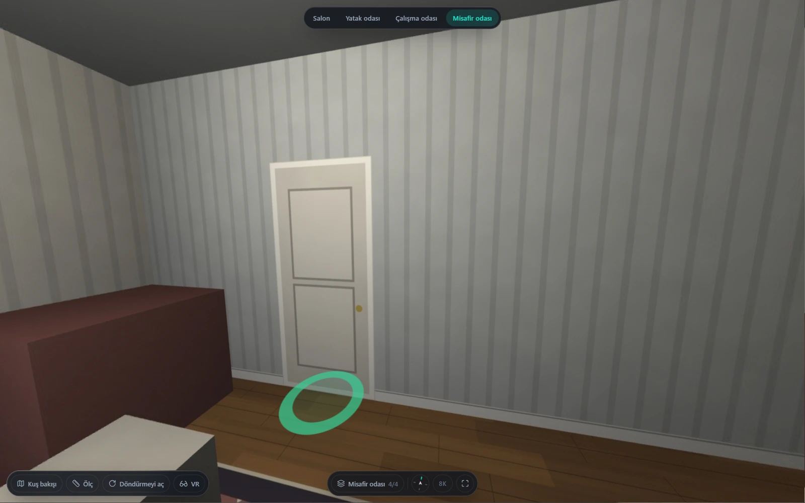
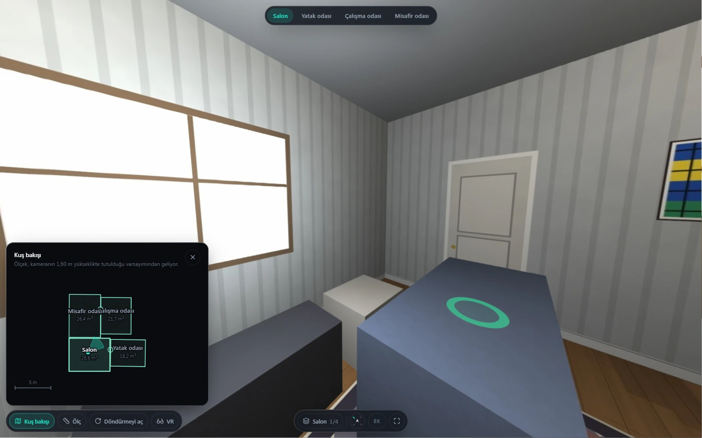
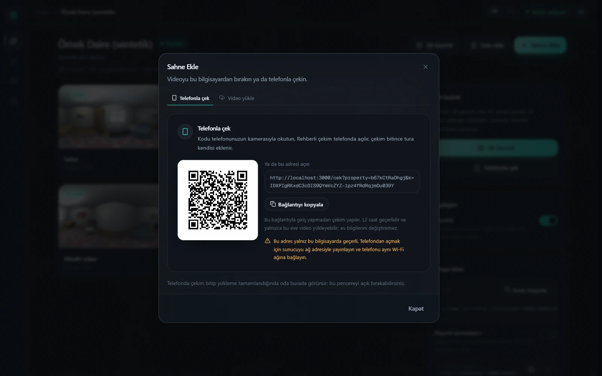
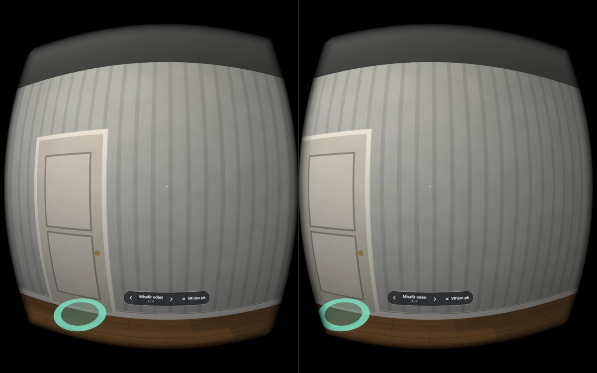

# BioSphere AI

**Turn a phone video into a 360° virtual tour — open source.**

[](LICENSE)


[Project site](https://biosphere.bilalgurkansanli.com) · [Türkçe README](README.tr.md) · [Architecture notes (Turkish)](docs/ARCHITECTURE.md) · [Contributing](CONTRIBUTING.md)

<table>
  <tr>
    <td></td>
    <td></td>
  </tr>
  <tr>
    <td></td>
    <td></td>
  </tr>
</table>

<sub>All screenshots show the engine's synthetic test rooms — no real home appears anywhere in this repository.</sub>

An estate agent stands in the middle of a room and turns a phone around for a minute. BioSphere
extracts the sharpest frames, solves how the camera rotated, stitches an equirectangular
panorama of up to 8K, and serves it in a web player that links rooms together, draws a floor
plan, measures distances, opens in VR and embeds in any listing page with an `<iframe>`. No
360 camera, no special hardware.

It began as a product for Turkish estate agents and is now an open, single-developer
engineering project. Everything here runs on one laptop.

---

## What is ready, and what is evolving

Status as of October 2026. Numbers are measured, not estimated; the measurements live
next to the code and in [docs/ARCHITECTURE.md](docs/ARCHITECTURE.md).

### ✅ Stable

| Feature | Notes |
|---|---|
| **Guided phone capture + 360 stitching** | Phone video → equirectangular panorama up to 8K. Rotation-only bundle adjustment with loop closure, mesh alignment against hand-held parallax, graph-cut seams, multi-band blending, pole fill. The reference real capture renders at 4096 px in **~170 s** (was 1278 s) on a 16-thread laptop. |
| **Synthetic quality gate** | Renders a procedural room, simulates a phone capture (motion blur, rolling shutter, exposure drift, real parallax) and scores the stitch against ground truth with solid-angle-weighted PSNR/SSIM. |
| **360 player** | Rooms linked by floor rings you walk through, a room bar, progressive resolution, embeddable `<iframe>`. |
| **Measurement & floor plan** | Distances on the floor, scaled from the camera height. Room outlines fitted from each panorama overlap the true floor at **0.984–0.991 IoU**, edges within 9 cm, on rooms of known size; the plan is editable by hand. |
| **Accounts, QR capture links, uploads** | The phone films from a QR code without signing in (a 12-hour token for one property, honoured only on an allow-list of capture routes). Chunked, resumable uploads; live job progress. |

### 🔑 Works with an Anthropic API key

| Feature | Notes |
|---|---|
| **Listing copy** | Title and description for Turkish listing portals; every number is audited against the measured facts. About $0.005 per listing on Claude Haiku. |
| **Investment assistant** | A chat inside the player about rental yield, payback, purchase costs, mortgage and the area's price trend. All arithmetic runs in deterministic engine tools, market data comes from web search with cited sources. Claude Sonnet 5.5 by default, about $0.03 per question, with per-listing and global daily budget caps. Estimates, not investment advice. |

### 🧪 Experimental

| Feature | Notes |
|---|---|
| **VR** | WebXR on headsets (Quest, Vision Pro) and a phone "VR box" (Cardboard) mode with lens correction and gaze selection, for both the 360 tour and the 3D walkthrough. 104 unit tests and a desktop check (`?vr=cardboard`); **not yet tried on a real headset or phone**. |
| **3D walkthrough** | A Gaussian-splat model from a walk-through video: ALIKED + LightGlue features, COLMAP/GLOMAP poses, Brush training, SOG export, PlayCanvas viewer. Works on carefully captured video; a fast, blurry or messenger-compressed phone video breaks into separate parts. Needs a GPU and about 30 minutes per build. |

### 🔭 Next step

| Feature | Notes |
|---|---|
| **Furniture removal & virtual staging** | Works as a prototype. Refilling furniture in panoramas from the room's own walls and floor cut the dark-smear share from 0.43–0.71 to 0.08–0.11, but with local models (LaMa, Stable Diffusion 1.5 + ControlNet, Mask2Former) it does not reach production quality: floors still come out flat, and staging re-skins the furniture rather than redesigning the room. That needs larger models and a real GPU budget, so I kept my focus on the core 360 engine — this is the next step. |

---

## The story

I designed BioSphere as a product for estate agents and built every layer myself — the
stitching engine (written from scratch, not on top of an off-the-shelf 360 library), 3D
reconstruction, the web player, the dashboard and the AI tools.

Then I met estate agents one by one. Most don't even shoot video for a listing, and a
one-minute 360 capture is, for most of them, either extra effort or simply not their
preference; large listing portals already offer a similar tour to their members for free. So
instead of shelving it, I made it open source — for anyone to access, use and build on. Having
built, end to end and on my own, a system that turns a phone video into a walkable 360° tour
genuinely makes me happy.

## How it works

```
360 tour
  phone video ─► sharp keyframes ─► feature matches ─► rotations (bundle adjustment + loop closure)
              ─► exposure & vignette ─► mesh alignment ─► graph-cut seams ─► multi-band blend
              ─► pole fill ─► 512 / 2048 / 4096 / 8192 px equirect ─► three.js player ─► <iframe>

3D walkthrough
  walk video ─► keyframes ─► ALIKED + LightGlue ─► COLMAP / GLOMAP ─► levelling & scale
             ─► rooms registered into the walk (Sim3) ─► Brush 3DGS training ─► clean ─► .sog
             ─► PlayCanvas viewer
```

The engine is Python (FastAPI, OpenCV, NumPy/SciPy, SQLite); the dashboard, capture app and
players are Next.js 16 / React 19 with three.js and PlayCanvas. Design decisions and the
measurements behind them are written up, in Turkish, in [docs/ARCHITECTURE.md](docs/ARCHITECTURE.md).

## Quick start

### Requirements

| | |
|---|---|
| **FFmpeg** | 6+ (frame extraction and encoding) |
| **Python** | 3.11–3.13, managed with [uv](https://docs.astral.sh/uv/) |
| **Node** | 22+ |
| **GPU** | Optional. With CUDA, studio mode uses RAFT optical flow; without, OpenCV DIS on the CPU. Required for the 3D walkthrough and the AI tools. |

The scripts are written for Windows (PowerShell), where the project was developed. Linux and
macOS work with the manual steps below.

### Windows

```powershell
./scripts/setup.ps1            # add -Gpu for CUDA PyTorch and the AI extras
./scripts/dev.ps1              # engine on :8008, dashboard on :3000
```

Or double-click `scripts/start-dev.cmd`: it needs no PowerShell policy and opens the engine,
the dashboard and (if you made a certificate) the phone proxy, each in its own window.

If PowerShell refuses to run local scripts, start them with
`powershell -ExecutionPolicy Bypass -File ./scripts/setup.ps1`.

### Manual

```bash
# engine
cd engine
uv venv --python 3.12 .venv
uv pip install -e ".[dev]"            # extras: gpu, ai, listing, walkthrough
cp .env.example .env                   # every key is optional
.venv/bin/python -m uvicorn biosphere.api.main:app --port 8008   # Windows: .venv\Scripts\python.exe

# web (second terminal)
cd web
npm install
npm run dev
```

- Dashboard: <http://localhost:3000> — no sign-in on your own machine (`BIOSPHERE_AUTH_MODE=local`, the default); set `accounts` for an instance other people can reach.
- Engine: <http://127.0.0.1:8008> · API docs at `/docs`.
- `GET /api/v1/health` reports what this machine can do (FFmpeg, GPU, 3D walkthrough tools, AI models).

### Optional features

| Feature | What it needs |
|---|---|
| Listing copy, investment assistant | `uv pip install -e ".[listing]"`, then paste **your own** Anthropic key under **Settings** (`/ayarlar`) in the dashboard. No key ships with the project; `BIOSPHERE_LISTING_API_KEY` / `ANTHROPIC_API_KEY` in `engine/.env` also work |
| 3D walkthrough | `uv pip install -e ".[walkthrough]"` (pycolmap, kornia, LightGlue), the [Brush](https://github.com/ArthurBrussee/brush) v0.3.0 binary and `@playcanvas/splat-transform` — see the walkthrough section of `engine/.env.example` |
| Furniture removal, staging | `-Gpu` setup (PyTorch CUDA + the `ai` extra); model weights are downloaded on first use only if `BIOSPHERE_AI_ALLOW_DOWNLOADS=true` |
| Filming from a phone on your LAN | Camera and motion sensors need HTTPS: generate a local certificate (command in `scripts/certs/san.cnf`) and run `node scripts/lan-proxy.mjs`, then open `https://<your-LAN-IP>:3443` on the phone |

## Measuring quality

"No visible artefacts" is a measurement here, not an opinion:

```bash
cd engine
.venv/bin/python -m pytest tests/test_pipeline_quality.py -q          # synthetic end-to-end gate
.venv/bin/python -m biosphere.synth.cli make-capture --style rich --trajectory three_row --effects realistic --out ./cap
```

## Development

```bash
cd engine && .venv/bin/python -m pytest -m "not slow"     # engine tests (~560)
cd web && npx tsc --noEmit && npm test                    # type check + ~630 unit tests
```

## Repository layout

```
engine/biosphere/
  pano/      360 stitching: frames, features, bundle adjustment, seams, blending, poles
  splat/     3D walkthrough: SfM, registration, Brush training, cleaning, export
  plan/      floor plans from panoramas
  ai/        furniture removal, virtual staging, measurement, listing copy
  invest/    investment assistant: calculators, rates, the streaming agent
  synth/     synthetic rooms and captures for the quality gate
  api/ core/ FastAPI routes, settings, database, storage, job queue
web/src/
  app/       site, dashboard, capture (/cek), embed player
  components/player · walk · vr · capture · invest · dashboard
docs/        architecture and algorithm notes (Turkish)
scripts/     setup, dev, LAN HTTPS proxy, tunnels
```

## Running a public instance

BioSphere stores everything locally (SQLite and a media folder). If you run it for other
people, you are the operator: you need your own privacy notice and terms, and the optional AI
features send data to Anthropic when they are switched on.

## Contributing

Issues and pull requests are welcome — see [CONTRIBUTING.md](CONTRIBUTING.md). Places where
help would matter most: better furniture-removal models, testing VR on real headsets and phones,
a capture guide for 3D walkthroughs, Linux/macOS setup scripts and a Docker image. Security
issues: [SECURITY.md](SECURITY.md).

## Acknowledgements

Built on the work of many open-source projects, among them OpenCV, NumPy/SciPy, FastAPI,
three.js, PlayCanvas and `splat-transform`, Brush, COLMAP/pycolmap/GLOMAP, LightGlue and ALIKED,
DINOv2, LaMa, Stable Diffusion, Mask2Former and Depth Anything. Model weights are not included
in this repository and keep their own licences — see [THIRD_PARTY_NOTICES.md](THIRD_PARTY_NOTICES.md).

## License

[MIT](LICENSE) © 2026 Bilal Gürkan Şanlı and the BioSphere AI contributors.
